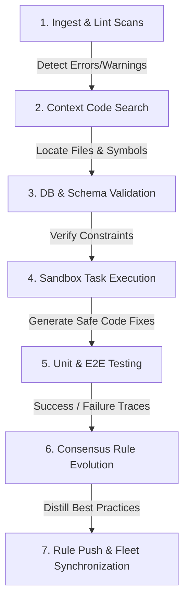

# 🧠 Codebase Self-Healing Workflow (/jean-self-healing-code)

The cognitive code repair cycle. Code-named `/jean-self-healing-code`, this advanced operational playbook details the closed-loop automation pipeline: parsing workspace linters, mapping codebase references, validating active schemas, running sandboxed agentic repairs, verifying test suites, and committing consensus rule evolutions to fleet nodes.

---

## 🌀 Self-Healing Code Loop



---

## ⚡ Step-by-Step Self-Healing Guide

### Step 1: Automated Workspace Hygiene Scan
Scan the target directory for compile warnings, type errors, or lint failures:
- **Command (Hygiene sweep)**:
  // turbo
  ```bash
  npm run lint --prefix /home/krusch/homelab/projects/$PROJECT_NAME
  ```

### Step 2: Codebase Context & Symbol Mapping
If structural errors or deprecations are found, locate all referencing files and declarations using semantic vector code search:
- Call `krusch_git_semantic_search({ repo: "$PROJECT_NAME", query: "<error_symbol> patterns" })` or `krusch_git_search_symbols`.

### Step 3: Database & State Verification
Check for structural drift in SQLite or PostgreSQL configurations:
- Run structural schema validation sweeps to verify keys, relations, indexes, and vector spaces match seeds.

### Step 4: Sandboxed Code Repair Execution
To prevent workspace corruption, execute task repairs inside an isolated sandbox container:
1. Dispatch the repair intent to the local DBOS Swarm worker.
2. The sub-worker executes code edits autonomously inside the staging container using AST tools, conforming to the monorepo's modern ESM standard.

### Step 5: Test Suite Verification
Run the project's test scripts to ensure the auto-healing task resolved the lint or compile error without introducing regressions:
- **Command (Test validation)**:
  // turbo
  ```bash
  npm run test --prefix /home/krusch/homelab/projects/$PROJECT_NAME
  ```
- If the test pass rate is `<100%`, revert staging files and trigger secondary diagnostics.

### Step 6: Closed-Loop Lessons & Rule Evolution
Distill the successful repair sequence into a permanent organizational rule to prevent future recurrences:
1. Identify the root cause (e.g. *“Using deprecated CJS require statements in Express models causes boot crashes”*).
2. Write a lightweight structural rule back to episodic memory:
   - Call `krusch_context_remember({ category: "lesson", project: "$PROJECT_NAME", content: "RESOLVED: Migrated legacy CJS require modules to standard ES imports to prevent microservice startup warnings." })`.

---

## 🛠️ Diagnostics & Troubleshooting

| Symptom | Cause | Solution |
| :--- | :--- | :--- |
| Staged repairs fail to resolve lint errors | The sandbox worker lacks the required project dependencies | Verify `package.json` lockfile sync, run `npm install` inside the container, and retry |
| Staging test suite throws a timeout | Unhandled open database handles or event loop blocks in test files | Check for missing `beforeAll` / `afterAll` hook cleanup blocks in testing files |
| Rule synchronization fails | Target node is unreachable via Tailscale mesh VPN | Run connectivity sweep: `/home/krusch/homelab/scripts/check_nodes.sh` to restore mesh routing |

---

## 🔧 Explicit MCP Tool Playbook (Jean Autonomous Code & Companion Audit)

When verifying active IDE changes (`COMPANION_AUDIT`) or auditing project code (`CODE_AUDIT`), use these exact MCP tools before making any determination:

1. **Hydrate Project Invariants & Decisions (Tier 1 — `krusch-context-mcp`)**:
   - `krusch_context_retrieve({"query": "<project>", "include_state": true, "limit_tokens": 2000})`
   - `krusch_context_nudge({"trigger": "pre_commit", "code": "<diff_or_snippet>", "file_path": "<rel_path>"})`
2. **Inspect Complete Symbol Declarations & Call Graphs (Tier 2A — `krusch-git`)**:
   - `krusch_git_file_symbols({"repo": "<project>", "file_path": "<rel_path>"})`
   - `search_symbols <symbol_name>` / `krusch_git_search_symbols({"repo": "<project>", "query": "<symbol_name>"})`
   - `dependency_graph <symbol_or_file>` / `krusch_git_dependency_graph({"repo": "<project>", "symbol": "<symbol_or_file>"})`
   - `krusch_git_semantic_search({"repo": "<project>", "query": "<pattern_or_behavior>"})`
   - `read_file <rel_path>:<startLine>-<endLine>` (always read the full symbol range `startLine-endLine` before flagging a bug)
3. **Inspect Docs, Specs & Configs (Tier 2B — `krusch-fs`)**:
   - `krusch_fs_locate({"pattern": "<glob>", "node": "kruschdev"})`
   - `krusch_fs_page_tree({"path": "<project_path>/<file>", "node": "kruschdev"})`
   - `krusch_fs_read_page({"path": "<project_path>/<file>", "page_number": 1, "node": "kruschdev"})`
4. **Verify UI/Frontend Standards (`krusch-frontend-mcp`)**:
   - `query_design_rules({"queryStr": "<ui_topic>"})`
   - `analyze_layout_structure({"htmlString": "<html_or_jsx>"})`

