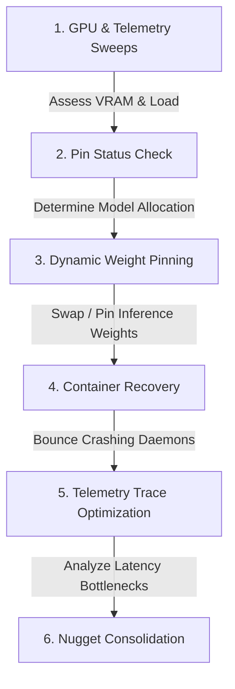

# 🐳 Infrastructure Self-Healing & Tuning Workflow (/jean-self-healing-infra)

The system-level reliability playbook. Code-named `/jean-self-healing-infra`, this advanced manual enables **Jean SRE** and fleet workers to dynamically poll hardware performance telemetry, analyze GPU VRAM allocations, optimize LLM weight pinnings, execute container bounces, and run OpenTelemetry latency optimizations.

---

## 🌀 Self-Healing Infrastructure Loop



---

## ⚡ Step-by-Step Infrastructure Tuning Guide

### Phase 1: Hardware & GPU Telemetry Scans
Monitor host loads, temperatures, and physical memory footprint across active fleet nodes:
- **Command (System performance probe)**:
  // turbo
  ```bash
  /home/krusch/homelab/scripts/check_nodes.sh
  ```
- **Command (NVIDIA GPU hardware check)**:
  // turbo
  ```bash
  ssh kruschdev "nvidia-smi --query-gpu=temperature.gpu,utilization.gpu,utilization.memory,memory.total,memory.free --format=csv,noheader"
  ```
  > [!IMPORTANT]
  > **Thermal Gating**: If any node GPU crosses `85°C`, instantly halt intensive processing, invoke dynamic offloading (see `/jean-thermal-rescale`), and send a warning card to the human loop gate.

### Phase 2: VRAM Allocation Audits
Determine which LLM weights are currently active in physical GPU caches across all 3 primary nodes and verify `100% GPU` (`0% CPU`) and `UNTIL Forever` residency:
- **Command (Model status check across all 5 GPUs)**:
  // turbo
  ```bash
  ollama ps && ssh kruschdev "ollama ps" && ssh kruschserv "ollama ps"
  ```

### Phase 3: Dynamic Model Weight Pinning (`keep_alive: -1`)
Optimize token generation speeds and prevent model load/unload swaps across the Multi-Family 5-GPU Fleet:
1. **`kruschdev` (Dual RTX 2080 Ti NVLink)**: Pin `qwen3-coder-30b-moe:latest` (`num_ctx: 16384`, `q8_0` KV cache, `num_gpu: 99`, `keep_alive: -1`) as Jean SRE `PERSONA_MODEL`.
2. **`kruschserv` (Dual RTX 3060)**: Pin `gemma4:e4b` (`num_ctx: 16384`, `q8_0` KV cache, `keep_alive: -1`) as Jean SRE `EXECUTOR_MODEL` alongside `hermes3:latest` (`num_ctx: 16384`, `q8_0` KV cache, `keep_alive: -1`).
3. **`krusch` (Single RTX 2080 Ti)**: Pin `bge-large:latest` (`512` ctx, `keep_alive: -1`) + `qwen2.5-coder:7b` (`16384` ctx, `q8_0` KV cache, `keep_alive: -1`).

### Phase 4: Container Auto-Recovery (Stale/Looping services)
If a staging or production container is unresponsive or continuously failing health endpoint checks:
1. Identify the container name and source node.
2. Gracefully bounce the container using Docker:
   ```bash
   ssh $TARGET_NODE "docker restart $CONTAINER_NAME"
   ```
3. Verify status: `docker ps | grep $CONTAINER_NAME`.

### Phase 5: OpenTelemetry / HALO Trace Optimizations
For deep trace analysis, execute the HALO optimization suite to pinpoint latency bottlenecks, database transaction lockups, or thread blockages:
// turbo
```bash
bash /home/krusch/homelab/projects/halo/run_halo.sh --analyze-latency
```

### Phase 6: Nuggets Memory Persistence
Record successfully applied hardware parameters as permanent operational hints:
- Call `krusch_context_remember({ category: "invariant", key: "gpu-tuning", content: "Locked qwen3-coder-30b-moe:latest (kruschdev Dual 2080 Ti NVLink), gemma4:e4b + hermes3:latest (kruschserv Dual 3060), and bge-large:latest + qwen2.5-coder:7b (krusch 2080 Ti) at 100% GPU with keep_alive: -1." })`.

---

## 🛠️ Diagnostics & Troubleshooting

| Symptom | Cause | Solution |
| :--- | :--- | :--- |
| GPU stats command fails | NVIDIA driver desync or host GPU offline | Restart nvidia drivers: `sudo systemctl restart nvidia-persistenced` or reboot target host node |
| Container fails to recover after restart | Port binding collision or corrupted volume lockfile | Force-kill container, remove lockfiles from staging volumes, and restart via `docker-compose up -d --force-recreate` |
| Trace analyzer cannot locate trace logs | OpenTelemetry daemon is not running on the target node | Verify collector status: `docker ps | grep otel-collector` and verify config bindings |

---

## 🔧 Explicit MCP Tool Playbook (Jean Autonomous Infra Sweep)

When executing autonomous infrastructure sweeps across the 3 primary compute nodes (`krusch`, `kruschdev`, `kruschserv`), use the exact Sentinel & Context MCP tool calls matching the active focus area:

- **`docker` focus**:
  - `get_docker_containers({"node": "<node>"})`
  - `get_service_logs({"node": "<node>", "service": "<container_or_unit>", "lines": 50})`
  - `get_docker_daemon_config({"node": "<node>"})`
- **`storage` focus**:
  - `get_disk_usage({"node": "<node>"})`
  - `get_mount_options({"node": "<node>"})`
  - `find_large_files({"node": "<node>", "path": "/mnt", "min_size_mb": 500})`
  - `krusch_fs_locate({"pattern": "*", "node": "<node>"})`
- **`gpu` focus**:
  - `get_gpu_stats({"node": "<node>"})`
  - `get_process_health({"node": "<node>"})`
- **`system_tuning` focus**:
  - `get_system_stats({"node": "<node>"})`
  - `get_sysctl_params({"node": "<node>"})`
  - `get_cpu_governor({"node": "<node>"})`
  - `get_network_tuning({"node": "<node>"})`
- **`services` focus**:
  - `list_systemd_services({"node": "<node>"})`
  - `get_service_logs({"node": "<node>", "service": "<service_name>", "lines": 50})`
- **`security_self_state` focus**:
  - `audit_agent_self_state({"node": "<node>"})`
  - `detect_memory_anomaly({"node": "<node>"})`
  - `verify_state_integrity({"node": "<node>"})`

